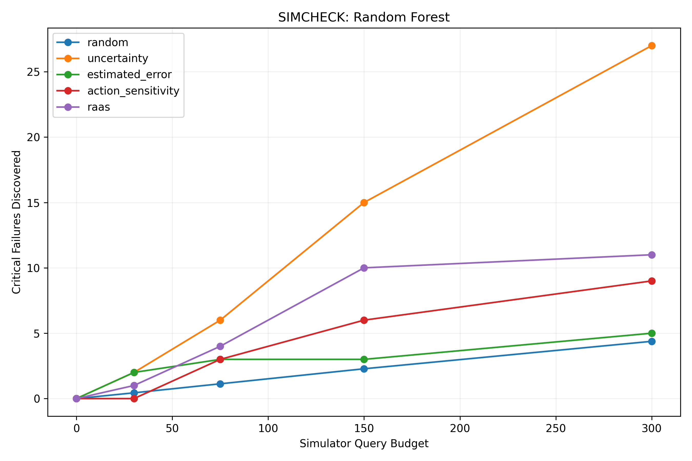
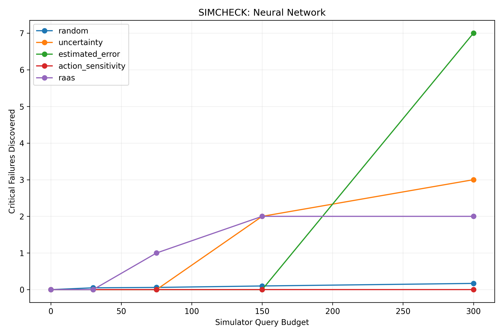
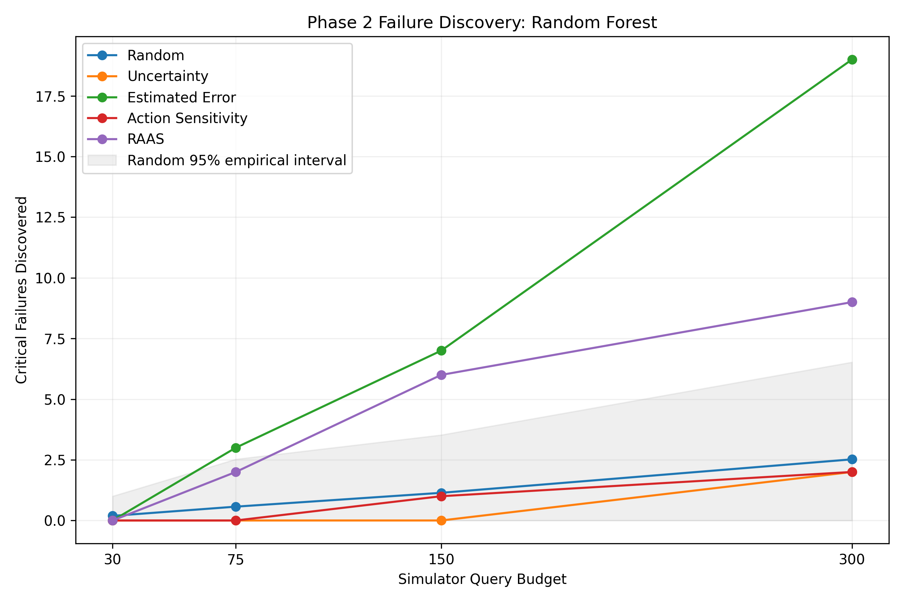
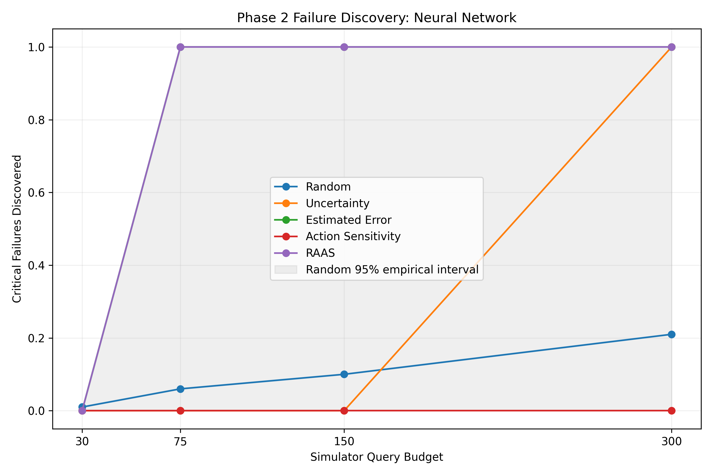

# SIMCHECK

## Overview

A learned world model can predict an environment reasonably well on average and still make mistakes that matter when an AI agent chooses what to do next. If checking a model against the real environment is expensive, which states should we test first?

**SIMCHECK** investigates this question by comparing methods for finding prediction errors that affect decisions when the number of simulator checks is fixed. I built two synthetic combat environments, trained random forest and neural network world models, and evaluated five strategies for selecting candidate states to test.

The project was motivated in part by research on learning policies inside simulated game environments, including Jordy Kieto’s [*Learning in Dreams, Winning in Reality: A Continuous Dyna Loop for a Ten-Hero MOBA*](https://arxiv.org/abs/2610.08033). That work examines how a policy trained with a learned world model performs in the real game. SIMCHECK asks a complementary question: **how can we find the model errors most likely to change an agent’s decisions before spending a large evaluation budget?**

> **Scope:** These experiments use custom, simplified simulators. They do **not** evaluate Riot Games’ production systems, League of Legends gameplay, or the PufferLib MOBA environment used in the motivating paper.

## Research question and hypothesis

**Research question:** Given a limited number of simulator queries, which testing strategy discovers the most states where a learned world model leads an agent to make a worse decision?

I investigated whether **Risk-Aware Action Sensitivity (RAAS)**, a strategy intended to prioritize states where prediction differences may have high decision consequences, could outperform simpler selection approaches.

The working hypothesis was that prioritizing situations where a poor choice could be costly would uncover more critical failures than random selection or action sensitivity alone. The experiments also compare RAAS against methods based on uncertainty and estimated error.

## Experimental design

| Component | Design |
|---|---|
| Environments | Two custom synthetic combat simulators |
| World models | Random forest and neural network |
| Candidate pool | 5,000 candidate states set aside for testing per phase |
| Evaluation budgets | 30, 75, 150, and 300 simulator queries |
| Random baseline | 100 random draws per model and budget |
| Ranked methods | One fixed ranking per model and method, evaluated at each budget |
| Critical failure threshold | Decision regret ≥ 20 in the experiment's reward units |
| Main outcome | Number of critical decision failures discovered within a query budget |

**Decision regret** measures how much worse the model’s chosen action performs in the simulator compared with the best action available in that state. Each check evaluates one move. With three moves per state, 300 queries let me test all moves in 100 states.

For example, in Phase 2 candidate state 42, the random forest recommended using an ability. In the simulator, that move earned −108.85 reward points and left Vi at 0 HP. Retreat earned 0 points and left her at 58 HP. The difference was 108.85 points of decision regret, well above the 20-point cutoff.

### Phase 1: Simplified combat environment

The first phase uses a compact synthetic combat setting with **attack, dodge, and retreat** actions. It provides a controlled test bed for comparing ways to find failures and examining the behavior of the two learned models.

- Code: [`phase1/`](phase1/)
- Experiment summaries: [`phase1/results/`](phase1/results/)

### Phase 2: Combat environment inspired by League of Legends

The second phase uses a more detailed combat scenario inspired by Vi and Jinx with **attack, ability, and retreat** actions. Public champion data informed the setup. I wrote simplified combat rules for the experiment.

- Code: [`phase2/`](phase2/)
- Champion data: [`phase2/champion_data/`](phase2/champion_data/)
- Experiment summaries: [`phase2/results/`](phase2/results/)

## Testing strategies

Five strategies are compared under the same number of simulator queries:

1. **Random sampling:** Select candidate states without prioritization; a baseline for discovery by chance.
2. **Testing based on uncertainty:** Prioritize states where model predictions indicate greater uncertainty.
3. **Testing based on estimated error:** Prioritize states based on an error estimator trained with labeled validation information.
4. **Action sensitivity:** Prioritize states based on sensitivity of predicted action outcomes.
5. **Risk-Aware Action Sensitivity (RAAS):** Rank states using equal weights for normalized action sensitivity, vulnerability, and danger.

Equal *query budgets* do not mean equal total computational or information costs. For example, uncertainty estimation and supervised error estimation have different prerequisites. This matters when interpreting comparisons.

## Results

Here’s how many critical failures each method found with 300 simulator queries. Random sampling is averaged over 100 draws. Each other method reports the count from its fixed ranking.

| Environment / model | Random | Uncertainty | Estimated error | Action sensitivity | RAAS |
|---|---:|---:|---:|---:|---:|
| Phase 1 · Random forest | 4.38 | **27** | 5 | 9 | 11 |
| Phase 1 · Neural network | 0.17 | 3 | **7** | 0 | 2 |
| Phase 2 · Random forest | 2.52 | 2 | **19** | 2 | 9 |
| Phase 2 · Neural network | 0.21 | **1** | **1** | 0 | **1** |

*Bold marks the highest count in each row, including ties. The linked CSVs show the other budgets.*

### What I found

- At 300 queries, RAAS found more critical failures than average random sampling and plain action sensitivity in all four setups.
- The leading method depended on the simulator and model. Uncertainty led for the Phase 1 random forest. Estimated error led for the Phase 1 neural network and Phase 2 random forest. Uncertainty, estimated error, and RAAS tied at one failure each for the Phase 2 neural network.
- The number of failures available to find varied. In Phase 2, the full candidate pool contained 114 critical failures for the random forest and 10 for the neural network.
- These comparisons describe the trained models and candidate pools I tested.

### Plots of failures found

**Phase 1 · Random forest**



**Phase 1 · Neural network**



**Phase 2 · Random forest**



**Phase 2 · Neural network**



## Repository structure

```text
SimCheck/
├── phase1/                        # Simplified combat environment
│   ├── 01_simulation/
│   ├── 02_data_preparation/
│   ├── 03_model_training/
│   ├── 04_failure_detection/
│   ├── 05_experiments/
│   ├── 06_validation/
│   ├── 07_analysis/
│   ├── datasets/
│   ├── experiments/
│   └── results/
├── phase2/                        # League of Legends inspired combat environment
│   ├── 01_simulation/
│   ├── 02_data_preparation/
│   ├── 03_model_training/
│   ├── 04_failure_detection/
│   ├── 05_experiments/
│   ├── 06_validation/
│   ├── champion_data/
│   ├── datasets/
│   ├── experiments/
│   └── results/
├── .gitignore
└── README.md
```

## Exploring the experiments

Start with these files to inspect the recorded findings:

- [`phase1/results/budget_experiment_summary.csv`](phase1/results/budget_experiment_summary.csv)
- [`phase2/results/budget_experiment_summary.csv`](phase2/results/budget_experiment_summary.csv)
- [`phase1/results/statistical_analysis.csv`](phase1/results/statistical_analysis.csv)
- [`phase1/experiments/rankings_sha256.txt`](phase1/experiments/rankings_sha256.txt) and [`phase2/experiments/rankings_sha256.txt`](phase2/experiments/rankings_sha256.txt)

The scripts generate data, train models, rank candidate states, check each action against the simulator, and run the experiments at different query budgets. The trained `.joblib` models are **not** included in this repository because of their size.

You can inspect the recorded results in the tables and plots above. Reproducing the full experiment exactly still needs a verified setup, script order, and random seed configuration.

## Limitations and next steps

- Both environments are synthetic and much simpler than an actual MOBA.
- The evaluation measures regret for a single action at a time.
- The chosen regret threshold, state distribution, and candidate pool influence which failures count as critical.
- Each comparison uses the same number of simulator queries. Training, labeling, and computing costs can vary by method.
- The results describe fixed models and candidate pools. New training runs and candidate pools would help show how well the pattern holds up.
- A useful next step would be to test these methods for finding failures in a richer simulator or learned environment and measure whether targeted model corrections improve downstream agent performance.

## Motivation and related work

Jordy Kieto, [*Learning in Dreams, Winning in Reality: A Continuous Dyna Loop for a Ten-Hero MOBA*](https://arxiv.org/abs/2610.08033) (2026).

SIMCHECK is an independent exploration inspired by questions raised in research on world models. It is not affiliated with or endorsed by Riot Games.

## Author

**Lily Beyene**  
